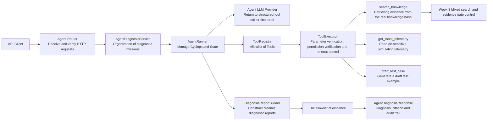
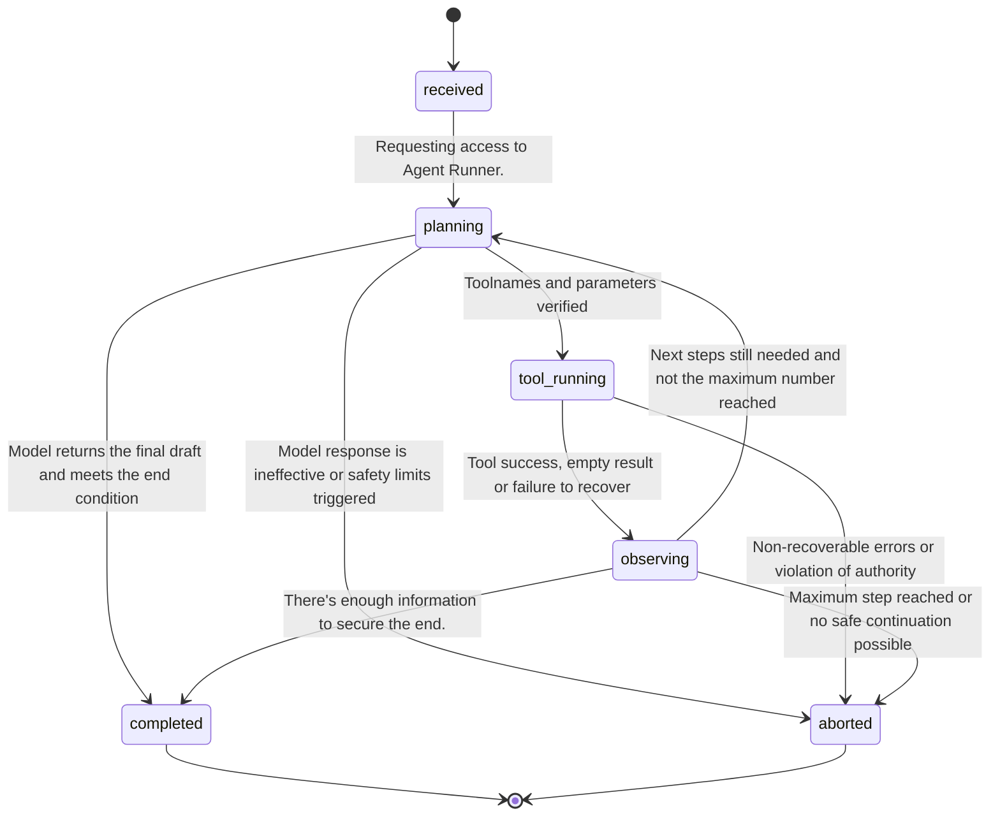
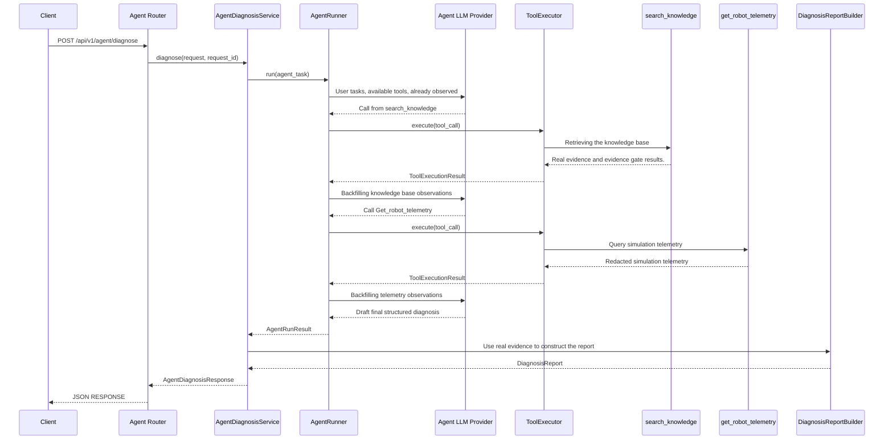

# Robot Diagnostic Agent Architecture

## 1. Purpose

This document defines the execution boundary, state flow, tool call chain, trust boundary, termination condition and failure path for Week 4 Diagnostic Agent.

This week's Agent does not directly control real robots, does not perform shell, Python, any network request or equipment operation. Agent can only select the next step from the application pre-registered tool, and all tools must be called by name verification, Pydantic parameter validation, permission verification and timeout control.

This document describes the target structure. Specific Pydantic Schema, Tool Registry, Tool Executor and AgentRunner will be achieved in the follow-up module.

## 2. Week 3 in relation to Week 4

### 2.1 Week 3 Fixed diagnostic link

`DiagnosisService` of Week 3 is executed in the order prescribed in advance by the procedure:

```text
DiagnosisRequest
→ Construct search questions and scope of search
→ GatedHybridRetriever
→ Evidence Gating
→ DiagnosisDraftProvider
→ DiagnosisReportBuilder
→ DiagnosisReport
```

This link is suitable for a single search to generate diagnostics. The programmer has determined each step in advance, so LLM cannot choose whether or not additional information needs to be sought.

### 2.2 Week 4 controlled Agent link

Week 4 adds to the existing diagnostic capacity the Agent layer:

```text
AgentDiagnosisRequest
→ AgentDiagnosisService
→ AgentRunner
→ LLM selects registered tool
→ ToolExecutor Implementation Tool
→ Results of the Agent Observation Tool
→ Continuation or closure of planning
→ DiagnosisReportBuilder
→ AgentDiagnosisResponse
```

Agent may choose to search the knowledge base first, search for analogies of telemetry or generate draft test examples based on the task, but cannot bypass the tool registration form and allowlist of evidence.

## 3. Overall component



### 3.1 Agent Router

Agent Router is responsible for:

1. Statement `POST /api/v1/agent/diagnose`;
2. Let FastAPI use Pydantic to verify the request;
3. Access through `Depends` `AgentDiagnosisService`;
4. Read `request_id` from `Request.state`;
5. Call Service and return the response.

Router does not achieve planning, tool execution, retrieval, LLM call or report assembly.

### 3.2 AgentDiagnosisService

AgentDiagnosisService is Agent's business entrance.

It is responsible for:

1. Convert API requests into Agent tasks;
2. Call `AgentRunner`;
3. Receives the result of the execution of Agent;
4. Re-use Week 3 for structured diagnosis and reference allowlist;
5. Construct the final `AgentDiagnosisResponse`.

Service does not allow the import of Python functions according to the dynamic name of the tool.

### 3.3 AgentRunner

AgentRunner is the controller of the state cycle.

It is responsible for:

1. Initialization of the implementation status;
2. Call Agent LLMProvider;
3. (a) The resolution of the structured tool call;
4. Give the tool call to ToolExecutor;
5. Preservation of tool results and audit events;
6. To determine whether to proceed with the next step;
7. Check maximum step and termination conditions;
8. returns the complete, partial or suspended execution result.

LLM can only request a tool to call. Implementation is decided jointly by AgentRunner, ToolRegistry and ToolExecutor.

### 3.4 ToolRegistry

ToolRegistry is the Allowlist of Tools.

It keeps the tool definition and processor that has been applied to the registration. A toolname returned by the model is only possible when a registration form exists.

ToolRegistry Prohibition of:

- Use `eval()` according to the model return value;
- Use `exec()` according to the model return value;
- Import modules according to any string dynamic;
- Search for a function of the same name outside the registration form;
- Execute a shell or device control command.

### 3.5 ToolExecutor

ToolExecutor is responsible for the uniform implementation of registered instruments.

The order of implementation is:

```text
Take ToolCall.
→ Query ToolRegistry
→ Verify whether the tool exists
→ Validate parameters using Pydantic
→ Check risk levels and read-only access
→ Apply single tool timeout
→ Call the Heave Tool Processor
→ Verify Tool Output
→ Return ToolExchangeResult
```

ToolExecutor is not responsible for deciding which instrument to call at a later stage, and this decision was initiated by AgentRunner and governed by security rules.

## 4. Agent Status Model

### 4.1 Status definition

Agent uses the following states during its life cycle:

| Status | Meaning | Is it final? |
|---|---|---|
| `received` | Request verified and entered API data | Yes |
| `planning` | Agent is deciding the next step based on the mission and observations already made. | Yes |
| `tool_running` | A verified tool is in progress. | Yes |
| `observing` | Tool results returned, Agent is recording and evaluating the results | Yes |
| `completed` | Agent normally terminates the execution cycle | Yes. |
| `aborted` | Agent aborted due to security restrictions or non-recoverable error | Yes. |

### 4.2 state flow



The status conversion can only be executed by the Python rules specified in AgentRunner. Neither user input nor document body, telemetry or LLM natural language can directly modify the state.

## 5. Distinction between the Agent state and the diagnostic status

Agent's implementation and final diagnostic status are two different concepts.

### 5.1 Agent execution status

Agent states that the cycle is normal or not:

- `completed`: the cycle ends normally in accordance with the rules;
- `aborted`: Cycles are forced to stop for technical or security reasons.

### 5.2 DiagnosisReport Status

`DiagnosisReport.status` of Week 3 describes the degree of completeness of evidence:

- `completed`: sufficient evidence to complete the diagnosis;
- `partial`: Partial conclusions can be provided, but the necessary information is still lacking;
- `abstained`: Insufficient evidence, conflict or low confidence, refusal to provide reasons and inspection movements.

It is therefore possible that:

| Agent Status | DiagnosisReport Status | Meaning |
|---|---|---|
| `completed` | `completed` | Agent, normal end and complete diagnosis |
| `completed` | `partial` | Agent's normal end, but the evidence only supports partial diagnosis. |
| `completed` | `abstained` | Agent, regular confirmation of current evidence. |
| `aborted` | `partial` | Agent has abnormally suspended, but some of the confirmed information is retained |
| `aborted` | `abstained` | Agent has suspended and not enough evidence to form a diagnosis. |

The `completed` of Agent cannot be interpreted as “failure confirmed” or “the diagnosis must be complete”.

## 6. Normal time series for execution



## 7. Data sources and trust borders

### 7.1 Application control data

The following are subject to application controls and are not allowed to be modified by users, documents, telemetry or LLM:

- System Prompt；
- ToolRegistry；
- Tool privileges;
- Maximum number of implementation steps;
- Timeout for single tools;
- Risk strategy;
- (a) Evidence gate control;
- Quoting allowlist;
- Conditions for termination.

### 7.2 Untrusted data

All of the following are considered untrustworthy data:

- (a) User submissions;
- Logs submitted by users;
- (a) The body of the document;
- Simulation of telemetry text;
- Tool returns text;
- LLM returns natural languages;
- LLM returns a tool parameter.

Non-credibility does not amount to a prohibition on use, but rather to data validation and cannot alter the rules of application.

### 7.3 data for final diagnosis.

The final diagnosis can only be used:

1. User input clearly marked `user_report` or `log_excerpt`;
2. Simulation telemetry clearly marked at `simulated_telemetry`;
3. `search_knowledge` Evidence from the knowledge base of this real return;
4. Draft diagnosis based on the above information and validated by Schema;
5. Quoted by allowlist of evidence.

LLM cannot directly generate real Chunk metadata, filenames, page numbers, similarities or telemetry sources.

## 8. Terminator

### 8.1 Normal completion

Access to `completed` if the following conditions are met:

- LLM returns results that match the final draft Schema;
- (b) No tool to be used for implementation;
- All references can be found in the allowlist of the results of this tool;
- High-risk findings meet the requirement for manual confirmation;
- The current result can be clearly marked as `completed`, `partial` or `abstained`.

### 8.2 Security aborted

Access to `aborted` shall be required in the following cases:

- Achieving maximum implementation steps;
- Request to call an unknown tool;
- (b) Requesting capacity other than the registration form;
- (b) Repetition to create a no-progress cycle;
- LLM returns invalid structures continuously;
- (b) The occurrence of non-recoverable instruments or upstream anomalies;
- Users require real robotic control;
- Tool calls attempt to exceed read-only privileges;
- (a) Injecting attempts to modify the system rules;
- It is not possible to produce stable results within the established limits.

### 8.3 Partial results

Credible evidence has been obtained, but some of the results can be returned when follow-up tools fail.

Some of the results must be:

- Retain the completed tool steps;
- (a) Retain only proven facts;
- Listing missing information;
- (a) Not to describe the non-implementation of steps as completed;
- The evidentiary threshold is not lowered to fulfil the mandate.

## 9. Failed Path

| Failed Scenarios | Stable approach |
|---|---|
| Unknown tool | Not implemented, record `unknown_tool` |
| Parameters Invalid | Not implemented, record `invalid_tool_arguments` |
| Tools timed out | Stop the tool. Record `tool_timeout`. |
| Tool returns empty result | Record `empty_result`, allow for reprogramming |
| Repeat Call | Record `duplicate_tool_call`, stop the infinite cycle. |
| Maximum number of steps reached | Record `max_steps_exceeded` and stop |
| LLM timeout | Record `llm_timeout`, maintain steps already taken |
| LLM returns invalid structure | Record `invalid_llm_response` |
| Upstream tool failed | Recording of a stable error code, undisclosed bottom response |
| Injection of hint | As normal data, do not change system rules |
| High-risk execution requests | Refusal to execute and request processing by manual or qualified personnel |

The error code is used for program judgement and evaluation, and the information is published to explain it to the user. Both cannot rely on the resolution of natural language logs.

## 10. Execute Track

At least every Agent event is recorded:

- `step_id`；
- `event_type`；
- `tool_name`；
- Summary of inputs after redacted;
- Summary of results after redacted;
- `status`；
- `duration_ms`；
- `error_code`。

The track record system actually did something that did not record the model's private thought chain.

The trajectory shall not contain:

- API Key；
- Full sensitive logs;
- Complete Prompt;
- (b) Unsensitized telemetry;
- (a) The model's private reasoning process;
- Unscreened upstream response.

## 11. Security not variable

The following rules are always in place regardless of the user input, document, tool result or LLM output:

1. Only the tools in ToolRegistry can be implemented;
2. Tool parameters must be validated through Pydantic;
3. All tools have time limits;
4. Agent has a maximum step limit;
5. (a) Not to carry out shell, python or network or equipment control of any kind;
6. (a) The result of the tool is not allowed to modify the system rules;
7. (b) Agent is not allowed to forge evidence from the knowledge base;
8. High-risk inspections must require certification by qualified personnel;
9. (b) `partial` or `abstained` when insufficient evidence is required;
10. The steps that have been completed and the reasons for the failure must be auditable.

## 12. Planned modular boundaries

The following modular structures are expected to be used for follow-up:

```text
app/
├── agent/
│   ├── __init__.py
│   ├── registry.py
│   ├── executor.py
│   ├── runner.py
│   └── tools/
│       ├── __init__.py
│       ├── knowledge.py
│       ├── telemetry.py
│       └── test_case.py
├── schemas/
│   └── agent.py
├── services/
│   └── agent_diagnosis.py
└── routers/
    └── agent.py
```

The functions of the modules are:

- `app/schemas/agent.py`: Data contracts defining Agent requests, status, tool calls, tool results, tracks and responses;
- `app/agent/registry.py`: Allowlist of Preservation Tools and Tool Definitions;
- `app/agent/executor.py`: performing name, parameters, privileges, time overruns and output verification;
- `app/agent/runner.py`: Achieving Agent state cycle;
- `app/agent/tools/knowledge.py`: Appropriate knowledge base search capability for Week 3;
- `app/agent/tools/telemetry.py`: read redacted simulation telemetry in memory;
- `app/agent/tools/test_case.py`: Generate draft test examples and do not perform tests;
- `app/services/agent_diagnosis.py`: Organization AgentRunner and DiagnosisReport;
- `app/routers/agent.py`: Exposure of HTTP interfaces, excluding business realization.
