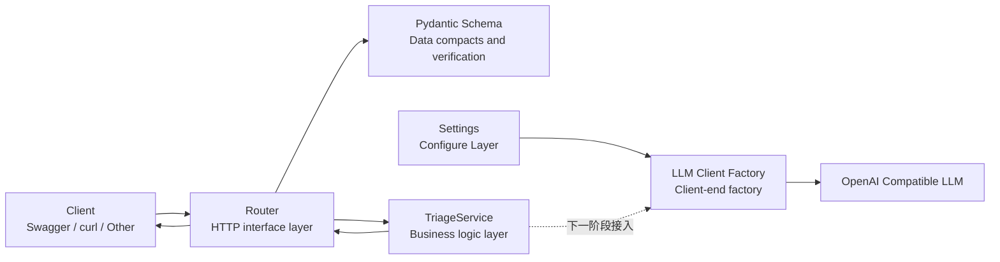

# Day 1–2 Learning and Development Notes

Date of record: 2026-08-05

Project name: Roberto Inciden Triage API

## 1. Objectives for the current phase

Day 1 – 2 aims to establish the smallest engineering skeleton for modern AI applications.


- The development environment can be replicated.
- FastAPI services can be steadily activated.
- API route has clear layers.
- The request and response have a clear data compact.
- Configure and key does not die in business code.
- LLM client will not be created when the module is imported.
- Follow-up can replace real and test services by relying on injection.

## 2. Current structure



We have already reached:

```text
Client
  → FastAPI Router
  → Pydantic Validation
  → TriageService
  → TriageResponse
  → JSON Response
```

The LLM client factory has been created but has not yet been injected into `TriageService`. This will be done on Day 3 – 4.

## 3. Current status of completion

### Engineering environment

- [x] Use Conda to create Python 3.11 environment
- [x] Current Python version is 3.11.15
- [x] Create `requirements.txt`
- [x] Installation of all items dependent
- [x] Use `python -m pip check` to verify dependency
- [x] Create `.gitignore`
- [x] Create `.env.example`
- [x] Confirming the truth, `.env` not submitted to Git
- [x] Create item `README.md`
- [x] Create engineering baseline documents

### FastAPI Baseline

- [x] Create FastAPI applications
- [x] Start service with Uvicorn
- [x] Achieved `GET /health`
- [x] Verify `/health` returns `200 OK`
- [x] Authentication Swagger UI available
- [x] Use of application plants `create_app()`

### Layer Structure

- [x] Create `routers/`
- [x] Create `schemas/`
- [x] Create `services/`
- [x] Create `utils/`
- [x] Move `/health` from `main.py` to independent Router
- [x] Create `triage` Router
- [x] Create `TriageRequest`
- [x] Create `TriageResponse`
- [x] Create `TriageService`
- [x] Use FastAPI `Depends` for injection into Service

### Configure with LLM client

- [x] Create configuration layer using `pydantic-settings`
- [x] Read LLM configuration from `.env`
- [x] Print results using `SecretStr` to protect API Key
- [x] Verify Base URL with `HttpUrl`
- [x] Use `lru_cache` Cache Settings
- [x] Create `AsyncOpenAI` client factory
- [x] Definition `LLMConfigurationError`
- [x] Returns specific error when authentication missing API Key
- [x] Confirm that the LLM client will not be created when the module is imported

## 4. Current project structure

```text
week-01code/
├── app/
│   ├── routers/
│   │   ├── __init__.py
│   │   ├── health.py
│   │   └── triage.py
│   ├── schemas/
│   │   ├── __init__.py
│   │   └── triage.py
│   ├── services/
│   │   ├── __init__.py
│   │   ├── llm_client.py
│   │   └── triage.py
│   ├── utils/
│   │   └── __init__.py
│   ├── __init__.py
│   └── config.py
├── docs/
│   ├── en_baseline.md
│   └── day1-2-progress.md
├── .env
├── .env.example
├── .gitignore
├── main.py
├── en_README.md
├── requirements.txt
└── week1.txt
```

`.env` is stored locally only and cannot be submitted to Git.

`__pycache__/` is an automatic bytes cache generated by Python, which has been excluded by `.gitignore`.

## 5. Current Dependencies

`requirements.txt`：

```txt
fastapi
uvicorn[standard]
openai
pydantic-settings
pytest
pytest-asyncio
httpx
sse-starlette
```

Main responsibilities:

| Dependency                  | Duties                    |
| ------------------- | --------------------- |
| `fastapi`           | Definition of HTTP API, route and dependent injection   |
| `uvicorn`           | Run ASGI application and listen to HTTP requests |
| `openai`            | Call for OpenAI compatible LLM services  |
| `pydantic-settings` | Read configurations from environmental variables and `.env`    |
| `pytest`            | Development and operation of automated testing            |
| `pytest-asyncio`    | Test the stept function                |
| `httpx`             | Send HTTP request and test for apogee API   |
| `sse-starlette`     | Achieve SSE Fluent Response           |

Current installed OpenAI Python SDK version:

```text
openai 2.53.0
```

## 6. Current interface

### `GET /health`

Duties: to determine whether the service process of FastAPI is able to respond properly.

Requests:

```http
GET /health
```

Response:

```json
{
  "status": "ok"
}
```

Authenticated:

```text
200 OK
```

The health check does not currently visit LLM, avoiding upstream model failure leading to the miscalculation of the current API service as death.

### `POST /api/v1/triage`

Duties: To receive information on robotic failure and to return the breakdown summary and recommendations for screening.

The current interface has been structured, but the result of the location has been returned and no real LLM has been called.

Examples of valid requests:

```json
{
  "robot_id": "robot-001",
  "symptom": "机器人无法移动",
  "log_excerpt": "ERROR motor_controller: motor timeout"
}
```

Current response examples:

```json
{
  "request_id": "自动生成的 UUID",
  "summary": "已接收机器人 robot-001 的故障信息，LLM 分析服务尚未接入。",
  "recommended_actions": [
    "确认日志已经完成脱敏",
    "等待后续分析服务返回结果"
  ]
}
```

Authenticated:

- Effective request for return `200 OK`.
- Returns `422` when the required fields are missing.
- The empty `log_excerpt` was rejected by Pydantic.
- No additional field declared was rejected.
- Strings are automatically cleared with space at the end of the space.

## 7. Current data compact

### `TriageRequest`

Required fields:

| Fields            | Type    | Limits         | Role         |
| ------------- | ----- | ---------- | ---------- |
| `robot_id`    | `str` | 1 ~100 characters   | Identifies a malfunctioning robot. |
| `symptom`     | `str` | 1 ~1000 characters  | Describe observed failures |
| `log_excerpt` | `str` | 1 ~10000 characters | Provide post-sensitization log clips |

Configure:

```python
model_config = ConfigDict(
    str_strip_whitespace=True,
    extra="forbid",
)
```

Role:

- Automatically removes the lead space of the string.
- Prevents pure space bypassing non-empty verification.
- Rejects that there are no declared fields in Schema.
- Client field spelling error detected early.

### `TriageResponse`

Response field:

| Fields                    | Type          | Role          |
| --------------------- | ----------- | ----------- |
| `request_id`          | `str`       | The only way to track this request is to follow it.    |
| `summary`             | `str`       | Return to Prudential Fault Summary   |
| `recommended_actions` | `list[str]` | Returns the Query Operation of the Recommended Execution |

`request_id` Currently generated using `uuid4()`.

The same future `request_id` will run through:

```text
Router → Service → LLM → SSE → Log
```

## 8. Current layered duties

### `main.py`

Create and assemble FastAPI applications:

```text
FastAPI Application
├── health_router
└── triage_router
```

`main.py` does not contain a specific business logic.

### `routers/`

Responsible for HTTP Protocol Layer:

- Defines the request methodology and URL.
- Declare request and respond to Schema.
- Receives verified data.
- Call Service.
- returns the HTTP response.

Router is not responsible for organizational complexity or direct realization of LLM analytical logic.

### `schemas/`

Responsible for data compacts:

- field type.
- Fields to be filled.
- Length limit.
- Enter validation.
- Response structure.
- OpenAPI document information.

### `services/`

Responsible for operational capacity:

- The trouble analysis process.
- (c) Phrasing organization.
- ILM call.
- ILM responds to resolution.
- Timeout and invalid response processing.

The current `TriageService` returns the position result, the next stage of which is to access real LLM.

### `config.py`

Responsible for central management:

- `LLM_API_KEY`
- `LLM_BASE_URL`
- `LLM_MODEL`

Business code is not directly called around `os.getenv()`.

### `utils/`

To preserve generic, independent enabling capacity.

No specific tool has been added to this directory at this time. It cannot be used as a collection of all "codes that don't know where to put them".

## 9. Service depends on injection

Router is currently adopting:

```python
service: Annotated[
    TriageService,
    Depends(get_triage_service),
]
```

Declare that you need `TriageService`.

Of which:

- `TriageService` is the true type of parameter.
- `Depends(get_triage_service)` is additional information provided to FastAPI.
- FastAPI Call `get_triage_service()` created object.
- The client does not need to submit `service` in the request JSON.

Call process:

```text
HTTP Request
    ↓
FastAPI Validation TriageRequest
    ↓
FastAPI Call get_triage_service ()
    ↓
FastAPI Injecting Service into Router
    ↓
Router calls www service.analyze (request)
```

Tests can use FastAPI relying coverage, replacing real Service with Fake Service.

## 10. Configure Layer

Current Settings:

```python
class Settings(BaseSettings):
    llm_api_key: SecretStr | None = None
    llm_base_url: HttpUrl | None = None
    llm_model: str | None = None
```

_Other Organiser

```text
.env / System Environment Variable
          ↓
       Settings
          ↓
Client Plant and Service
```

After using `SecretStr`, print API Key directly shows:

```text
**********
```

`SecretStr` does not encrypt the key, but only reduces the risk that the key will be accidentally printed into the log.

Settings uses `lru_cache`:

```python
@lru_cache
def get_settings() -> Settings:
    return Settings()
```

Reads the configuration on your first call, then returns the cache object.

Changes to `.env` require the service to be restarted in order to read the new configuration.

## 11. LLM Client Plant

The current client plant is located at:

```text
app/services/llm_client.py
```

Main interfaces:

```python
def create_llm_client(settings: Settings) -> AsyncOpenAI:
    ...
```

The factory is responsible for:

- Check API Key.
- Get the real key from `SecretStr`.
- Converts Base URL.
- Sets the client timeout.
- Create `AsyncOpenAI`.

Model names passed:

```python
def get_llm_model(settings: Settings) -> str:
    ...
```

Separately, because the model name is not a parameter when creating the client, but is specified in each model request.

The following global formulation was not used:

```python
client = AsyncOpenAI(...)
```

The reason is that a global client is created during the module import phase, which may result in:

- The entire application cannot be imported if the key is not configured.
- `/health` affected by LLM configuration.
- Tests the unexpected creation of a real client.
- Clients are not easy to replace.
- The timing of initialization cannot be controlled.

The current design will create a client only when the plant is called visible.

## 12. Manual validation completed

### Python Environment

```powershell
python --version
```

Results:

```text
Python 3.11.15
```

### Reliance on integrity

```powershell
python -m pip check
```

Results:

```text
No broken requirements found.
```

### Start service

```powershell
python -m uvicorn main:app --reload
```

### Health screening

```powershell
curl.exe http://127.0.0.1:8000/health
```

Results:

```json
{"status":"ok"}
```

Server log:

```text
GET /health HTTP/1.1 200 OK
```

### Pydantic valid data

```powershell
python -c "from app.schemas.triage import TriageRequest; data = TriageRequest(robot_id='  robot-001  ', symptom='无法移动', log_excerpt='motor timeout'); print(data.model_dump())"
```

Results:

```text
{ 'robot_id ': 'robot-001 ', 'symptom ': 'unmoveable', 'log_excerpt ': 'moter timeout'}
```

### Invalid data for Pydantic

Empty `log_excerpt` will create:

```text
ValidationError
String should have at least 1 character
```

### LLM module security import

```powershell
python -c "import app.services.llm_client; print('导入成功，没有创建客户端')"
```

### Create LLM client

```powershell
python -c "from app.config import get_settings; from app.services.llm_client import create_llm_client; client = create_llm_client(get_settings()); print(type(client).__name__)"
```

It is anticipated that:

```text
AsyncOpenAI
```

This command creates only a client, does not send a network request and does not incur LLM call costs.

### Simulation missing API Key

```powershell
python -c "from app.config import Settings; from app.services.llm_client import create_llm_client; settings = Settings(_env_file=None, llm_api_key=None, llm_base_url=None, llm_model=None); create_llm_client(settings)"
```

Anticipated error:

```text
LLMConfigurationError: LLM_API_KEY not configured
```

## 13. Conclusion at the current stage

Day 1 – 2 has been completed for engineering skeletons.

Current applications have:

- Runable FastAPI service.
- Clear Router, Schema, Service, Config Layer.
- Strict requests and responsive contracts.
- Replaceable Service dependency.
- Centralized environmental variable management.
- Delays creating a different LLM client.
- Clear missing configuration error.

There is still no real call to LLM, and `POST /api/v1/triage` returns is a seating response.
