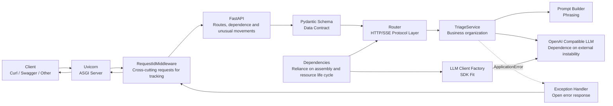

# Week 1 Code Walkthrough and Technical Details

## 1. Document target and current conclusion

This document allows readers to understand the composition, mode of operation, data stream, unusual flow, current protocol and test method of 1 code by simply passing through a single markdown.

The current system provides three interfaces:

| Method and Path | Role | Response Method |
|---|---|---|
| `GET /health` | Determines whether the current API process is responsive | Normal JSON |
| `POST /api/v1/triage` | Generate summaries and recommendations based on robotic failure information | Full JSON |
| `POST /api/v1/triage/stream` | Gradually return the text generated by the model | SSE Event Stream |

Week 1 focuses not on "writing a function of a call model" but on creating an AI application service boundary that can be maintained:

```text
HTTP and Protocol Layer
    ↓
Data input/output compact
    ↓
Business formation level
    ↓
LLM SDK Fitting Levels
    ↓
External OpenAI Compatible LLM
```

The accompanying capacity also includes:

- (a) Centralization and key protection;
- FastAPI Reliance on injection;
- (a) The call of the walk-in network;
- Request ID tracking;
- Apply uniform mapping of anomalies and HTTP/SSE errors;
- (b) Fake, Mock and Networkless Automation Tests;
- Different life cycles of ordinary and fluid responses.

Current code has been reconfirmed:

```text
21 passed in 4.55s
```

Validation commands use `-B` and `-p no:cacheprovider` only to avoid creating bytes and pytest caches in a copy directory, without changing the test logic:

```powershell
python -B -m pytest -p no:cacheprovider tests -q
```

## 2. Overall structure

### 2.1 Component Relationships



### 2.2. Why are you tiered?

| Layer | For what? | I'm not supposed to be responsible for what. |
|---|---|---|
| `main.py` | Create application and assembly components | Specific trouble analysis operations |
| `middleware/` | All requested cross-cutting behaviour | Business rules unique to a particular interface |
| `routers/` | HTTP method, path, status and response protocol | Directly spell complex hints, parse SDK objects |
| `schemas/` | Input, Output and Internal Data Structure Validation | Networking or business process implementation |
| `dependencies.py` | Connect configuration, client, service | Achieving analytical algorithms |
| `services/` | Business organization, hints, LLM call and resolve | Concerned with specific HTTP Response |
| `config.py` | Read and verify configuration from environment | Spread key into business code |
| `errors.py` | Defines the application of an internal error syntax | Determines the specific expression of HTTP or SSE |
| `exception_handlers.py` | Translation of internal errors into open HTTP error | Call LLM or process business data |

The core of this design is "change isolation":

- When HTTP path changes, the main change is Router;
- When entering a change in format, mainly changes Schema;
- The LLM adaptor code is primarily modified when model suppliers or call parameters change;
- Major changes to `prompts.py` when business alerts are changed;
- Test to replace a Service or LLM client without starting a real network.

It also leaves a place for the RAG of Week 2. RAG search is a business capability, usually called by an independent Retriever from `TriageService` instead of writing about Router or Middleware:

```text
Router
  ↓
TriageService
  ├─ Retriever / RAG（Week 2）
  ├─ Prompt Builder
  └─ LLM Client
```

## 3. Actual project structure

```text
week-02code/
├── app/
│   ├── middleware/
│   │   ├── __init__.py
│   │   └── request_id.py
│   ├── routers/
│   │   ├── __init__.py
│   │   ├── health.py
│   │   └── triage.py
│   ├── schemas/
│   │   ├── __init__.py
│   │   ├── error.py
│   │   ├── stream.py
│   │   └── triage.py
│   ├── services/
│   │   ├── __init__.py
│   │   ├── llm_client.py
│   │   ├── prompts.py
│   │   └── triage.py
│   ├── utils/
│   │   └── __init__.py
│   ├── __init__.py
│   ├── config.py
│   ├── dependencies.py
│   ├── errors.py
│   └── exception_handlers.py
├── docs/
│   ├── en_baseline.md
│   ├── en_sse_protocol.md
│   ├── test-report.md
│   └── 工程复盘.md
├── samples/
│   ├── insufficient-evidence.json
│   ├── normal-operation.json
│   └── upstream-failure-request.json
├── tests/
│   ├── test_api_contract.py
│   ├── test_error_responses.py
│   ├── test_service_errors.py
│   ├── test_service_responses.py
│   └── test_stream.py
├── .env.example
├── .gitignore
├── main.py
├── en_README.md
├── requirements.txt
├── week1.txt
└── week2.txt
```

`__init__.py` makes the directory an importable Python package and describes the duties of the package with a modular document string. Currently, `utils/` have only illustrative documents and no practical tools; You can't put all the codes that you don't know where to put them.

## 4. Python concept to understand before running code

### 4.1 Modules, Packages and Imports

- A `.py` file is usually a module, e. g. `app.config` corresponds to `app/config.py`.
- A catalogue containing `__init__.py` can be used as a package, e. g. `app.services`.
- `from app.routers.health import router as health_router` Import `router` and change the current module to `health_router` to avoid conflict with other Router-like variables.
- Imports the module to execute the top level code of the module. Therefore, the project is not intentionally created at the import stage to create `AsyncOpenAI`, which prevents `/health` from being started when a key is missing.

### 4.2 Type label

Type labels mainly serve reading, editor tips, static checks and run-time resolution of FastAPI /Pydantic:

| Writing | Meaning |
|---|---|
| `str` | String |
| `str | None` | String or `None`, i. e. configuration can be missing |
| `list[str]` | List of elements that are strings |
| `dict[str, object]` | Key is a string with values for a dictionary of any object |
| `tuple[int, str, str]` | A group of three-positioned elements |
| `type[ApplicationError]` | Category `ApplicationError` or its sub-categories themselves are not unusual examples |
| `Literal["completed"]` | Only fixed string `completed` |
| `Annotated[T, Depends(f)]` | The real type is `T` with an additional FastAPI dependent metadata |
| `AsyncIterator[str]` | An inverted inverted device to obtain strings by `async for` each |
| `-> None` | Function has no meaningful return value |

Python itself does not usually block error parameters with generic type labels; Pydantic and FastAPI will take the initiative to read parts of the labels and verify or inject them accordingly.

### 4.3 `async`、`await`、`async for`、`async with`

- `async def` Defines the co-ordinated function. Called first and got the co-ordinated object, it had to be `await` before it really waited for it to be done.
- `await` is used to wait for walk-through operations, such as network requests, closing the client and checking connections. The cycle of events during the waiting period can run other tasks rather than keeping the entire line empty.
- `async for` Consumer anisode. Each LLM section may have to wait for the network to arrive, so normal `for` cannot be used.
- `async with` Use a different-step context manager. Entry and exit may require a walk-through operation, such as opening and closing HTTP streams.

"Step" is not equivalent to automatic parallels or faster functions; it mainly increases the co-optability of large I/O waiting scenarios.

### 4.4 `yield` and the silo generator

Normal `return` one-time end function; `yield` pauses after producing a value, and retains the local variable and execution position, which will continue in the next iterative period.

In `async def`, `yield` is used to form an arctic generator:

```python
async def example():
    # The first iterative period gets the first paragraph, and then the function is suspended.
    yield "第一段"

    # The second consecutive period of implementation was followed by the second paragraph.
    yield "第二段"
```

There are two different uses for this project. `yield` ：

1. `get_llm_client()` Dependence `yield`: Hand over the client to downstream and enter `finally` clean-up resources after response.
2. flow style `yield` in `stream_analysis()` and `event_generator()`: transmit content paragraph by paragraph to Router or client.

### 4.5 Decorators

`@装饰器` will register or package functions after the definition of function has been completed.

For example:

```python
@router.get("/health")
async def health_check():
    ...
```

This is not every request to " execute decorator text ", but to call `router.get("/health")` for decorative devices when module import, function definition, and then register `health_check` on Router's route chart. Please contact FastAPI to find the registered function according to method and path.

`@pytest.mark.asyncio` Adds pytest tags to the test function to allow the plugin to recycle events to perform a walk test.

### 4.6 `try`, `except`, `finally` and the abnormal chain

- `try`: Codes that may fail to implement.
- `except 某异常`: Only specified errors are processed, and the naked `except:` that hide Bug is not used.
- `finally`: Implementation is successful or unusual and suitable for resource clean-up.
- `raise 新异常(...) from exc`: Conversion anomalies while retaining the original anomaly at `__cause__`, and logs and debuggers still see bottom causes.

## 5. Reliance library and current actual version

`requirements.txt` states direct reliance, but no locked version. At present, Conda Environments are actually installed:

| Package | Current Version | Purpose of the project |
|---|---:|---|
| `fastapi` | 0.141.1 | API, Router, relying on injections, unusual treatment, OpenAPI |
| `starlette` | 1.3.1 | FastAPI Bottom ASGI, Request, Response, Middleware |
| `uvicorn` | 0.52.1 | Listen to the network and run the ASGI application |
| `openai` | 2.53.0 | `AsyncOpenAI` and OpenAI compatible API type/unusual |
| `pydantic` | 2.13.4 | Data models, validation, sequenced |
| `pydantic-settings` | 2.14.2 | Environmental variables and `.env` configuration models |
| `pytest` | 9.1.1 | Test collection, parameterization, assertion and reporting |
| `pytest-asyncio` | 1.4.0 | Run anisode test in pytest |
| `httpx` | 0.28.1 | API testing client and SDK abnormality test |
| `sse-starlette` | 3.4.6 | SSE Response Encoding with Event |
| `anyio` | 4.14.2 | FastAPI /Starlette/httpx rectangular infrastructure, indirect dependence |

The square brackets in `uvicorn[standard]` are extra, which indicates the installation of officially recommended additional dependencies on the Uvicorn basis to obtain more complete load, protocol and performance support.

## 6. `main.py`: Application assembly entrance

### 6.1 `FastAPI` Object

```python
application = FastAPI(
    title="Robot Incident Triage API",
    version="0.1.0",
)
```

`FastAPI(...)` Create ASGI application objects:

- `title` and `version` will enter OpenAPI Schema and show it at Swagger UI;
- Apply object to save route, rely on overlay, anomaly processor and Middleware configuration;
- It can eventually be executed by Uvicorn as a walkable object.

### 6.2 Applied plants `create_app()`

```python
def create_app() -> FastAPI:
    ...
```

The application plant consolidates " how to assemble applications " into one function. It is easier than all logic scattered at the top of the module:

- Create independent application examples in testing or future deployments;
- Control the registration order of components;
- Avoid placing business logic in the start-up document.

### 6.3 `add_exception_handler()`

```python
application.add_exception_handler(
    ApplicationError,
    application_error_handler,
)
```

It creates a map: any `ApplicationError` or subcategory that spreads to the FastAPI anomaly is given to `application_error_handler(request, exc)` to generate a response.

The registered processor does not equal the immediate call. It reflects control reversal: framework mastery of the life cycle of the request, and reverts to the function we provide when an anomaly occurs.

### 6.4 `add_middleware()`

```python
application.add_middleware(RequestIdMiddleware)
```

It registers the Middleware class into the application configuration. Starlette automatically calls its example when the request arrives after building the Middleware inn. Manual `middleware.dispatch(...)` is not required in the code.

If more than one user is registered later, Middleware, Starlette is now "post-registered on the more outer level":

```python
application.add_middleware(A)
application.add_middleware(B)
```

The request is about `B → A → Router` and the response is `Router → A → B`. There is only one self-defined Middleware, so there is no sequential conflict between the self-defined layers.

### 6.5 `include_router()`

```python
application.include_router(health_router)
application.include_router(triage_router)
```

`include_router()` Merge the registered Route in `APIRouter` into the main application route sheet. Router's just the routers, not the stand-alone servers.

### 6.6 `app = create_app()` and `main:app`

Uvicorn command:

```powershell
python -m uvicorn main:app --reload
```

Meaning:

- `python -m uvicorn`: allow the current Python environment to run in a modular manner Uvicorn, avoiding commands pointing to other environments;
- `main`: Import `main.py` module;
- `app`: Acquire the ASGI object called `app` from the module;
- `--reload`: Monitoring document changes and restarting sub-processes at the time of development is not suitable for production deployment.

(b) FastAPI for application layer route, validation, dependency and response.

## 7. `app/config.py`: Centralized configuration

### 7.1 `Settings(BaseSettings)`

`BaseSettings` is a configuration model provided by Pydantic Settings. When `Settings()` is created, it combines initializing parameters, environmental variables and `.env` content, then validates by field type.

Current field:

```python
llm_api_key: SecretStr | None = None
llm_base_url: HttpUrl | None = None
llm_model: str | None = None
```

- The field name `llm_api_key` can be read as `LLM_API_KEY` at `case_sensitive=False`;
- `None` Allow applications to be activated and provided with `/health` when LLM configuration is lacking;
- When entering the LLM link, you will be given a clear configuration error by the plant function.

### 7.2 `SettingsConfigDict`

```python
model_config = SettingsConfigDict(
    env_file=".env",
    env_file_encoding="utf-8",
    case_sensitive=False,
    str_strip_whitespace=True,
    extra="ignore",
)
```

Every meaning:

- `env_file=".env"`: looking for `.env` from the current work catalogue;
- `env_file_encoding="utf-8"`: read in UTF-8;
- `case_sensitive=False`: Configure names without case-sensitive;
- `str_strip_whitespace=True`: Clean up the string configuration first-end spaces;
- `extra="ignore"`: `.env` ignores the variables that are not stated in the current model, rather than let the entire application fail.

Note: `.env` relative path depends on the process work directory. The project command requires that the root directory be activated in order to stabilize it to find `.env`.

### 7.3 `SecretStr`

`SecretStr` is the type of packaging "reduced unexpected display ": Direct printing usually receives `**********`. Real value to call in a visible way:

```python
settings.llm_api_key.get_secret_value()
```

It is not encrypted and does not prevent the acquisition of an object's code reading key or replace the operating system key management. It only lowers the probability of accidental leaking of logs, debugging printing and models `repr`.

### 7.4 `HttpUrl`

`HttpUrl` will check if values are like valid HTTP/HTTPS URLs. SDK accepts the string, so the client plant eventually uses `str(settings.llm_base_url)` conversions.

### 7.5 `@lru_cache`

```python
@lru_cache
def get_settings() -> Settings:
    return Settings()
```

`lru_cache` from Python Standard Library `functools`. The parameter combination of no arguments is always the same, so after the first call, the subsequent call returns the same Settings object in the cache:

- Avoid reclassification of `.env` per request;
- (b) To ensure stable configuration views for the same process;
- The process is usually restarted after the change of `.env`;
- If the test changes the environment and calls again, `get_settings.cache_clear()` needs to be considered. The current test avoids this problem through direct construction `Settings(_env_file=None,...)`.

## 8. `app/errors.py`: Apply an error semantic

Unusual inheritance relations:

```text
Exception
  └─ RuntimeError
      └─ ApplicationError
          ├─ LLMConfigurationError
          ├─ LLMTimeoutError
          ├─ LLMUpstreamError
          └─ InvalidLLMResponseError
```

Why don't you just throw `HTTPException` in Service:

- Service is an operational layer and should not bind HTTP; it may also be called in the future by task queues, CLI or other agreements;
- `LLMTimeoutError` denotes “what happened” and the anomaly processor determines that the expression in HTTP is `504` and SSE `error`;
- Only the uniform capture of `ApplicationError` does not disguise bugs such as `TypeError`, `AttributeError` as normal business failures.

Unusual meaning:

| Unusual | Semantic |
|---|---|
| `LLMConfigurationError` | API Key or Model Name Missing/ Invalid |
| `LLMTimeoutError` | Wait upstream LLM timeout |
| `LLMUpstreamError` | Connection failed or upstream returned error state |
| `InvalidLLMResponseError` | Response empty, no candidate, not JSON or structural error |

There is currently no self-defined method for these categories and the main value is to provide a stable, accurately captured type of error.

## 9. `app/exception_handlers.py`: translation of abnormal to HTTP

### 9.1 `ErrorMetadata`

```python
ErrorMetadata = tuple[int, str, str]
```

This is a type alias, three locations in order: HTTP status code, open error code, open message. It does not create a new run-time type.

### 9.2 `ERROR_METADATA`

| Apply Abnormal | HTTP | Public code | Public message |
|---|---:|---|---|
| `LLMConfigurationError` | 503 | `llm_configuration_error` | LLM service not correctly configured |
| `LLMTimeoutError` | 504 | `llm_timeout` | LLM service response timed out |
| `LLMUpstreamError` | 502 | `llm_upstream_error` | LLM upstream services are temporarily unavailable |
| `InvalidLLMResponseError` | 502 | `invalid_llm_response` | LLM returned unmanageable responses |

- `502 Bad Gateway`: Current API requests upstream as gateways/calls are not available for upstream failure or response;
- `503 Service Unavailable`: Current service dependent configuration is not in place;
- `504 Gateway Timeout`: No response upstream within the specified time frame.

### 9.3 `get_error_metadata()`

```python
return ERROR_METADATA.get(
    type(exc),
    (500, "application_error", "应用处理请求时发生错误"),
)
```

- `type(exc)` Specific categories for obtaining unusual cases;
- `dict.get(key, default)` returns the map when it is available, or returns to the safety hole if it is not;
- Multiple groups can be directly unpacked to `status_code, error_code, public_message`.

An important detail: `type(exc)` is the exact search here, not `isinstance()`. If a new subcategory of `LLMTimeoutError` is not registered in the future, it falls to 500 and does not automatically inherit the 504 map.

### 9.4 `application_error_handler()`

Signature:

```python
async def application_error_handler(
    request: Request,
    exc: ApplicationError,
) -> JSONResponse:
```

FastAPI Enter the current Request and unusual examples after an abnormal match.

Steps for processing:

1. Call `get_error_metadata(exc)` for public HTTP information;
2. Read track ID safely with `getattr(request.state, "request_id", "unavailable")`;
3. `logger.warning()` Record requests for ID, unusual types and internal details at the service end;
4. Construction `ErrorDetail` and `ErrorResponse`;
5. `model_dump(mode="json")` converted to a serialized dictionary for JSON;
6. `JSONResponse(status_code=..., content=...)` code response.

The third parameter for `getattr()` is the default value when the attribute does not exist, which prevents the error processor itself from dropping `AttributeError` due to the loss of `request_id`.

The post is written:

```python
logger.warning(
    "application_error request_id=%s type=%s detail=%s",
    request_id,
    type(exc).__name__,
    str(exc),
)
```

`%s` Delayed formatting by logging when the real output is performed is more in line with the logs habits than an earlier construction of f-string. `__name__` is the current modular name, which allows for the location of logs.

Only logs are written for internal error text, and the client receives fixed security messages to prevent the leaking of URLs, vendor responses, keys or details.

## 10. `app/middleware/request_id.py`: Request tracking

### 10.1 Middleware location

Middleware packages all HTTP routers, suitable for "cross-the-clock focus" such as requests ID, access logs, CORS, authentication and time-consuming statistics.

Current request/response direction:

```text
Client Request
  ↓
RequestIdMiddleware Request phase
  ↓
FastAPI / Dependency / Router / Service
  ↓
RequestIdMiddleware Response phase
  ↓
Client Response
```

### 10.2 `BaseHTTPMiddleware`

`RequestIdMiddleware` Inheritance to Starlette's `BaseHTTPMiddleware` and covers:

```python
async def dispatch(
    self,
    request: Request,
    call_next: RequestResponseEndpoint,
) -> Response:
```

- `request`: Current HTTP requested object;
- `call_next`: the type of callable object provided by the framework approximates `Callable[[Request], Awaitable[Response]]`;
- `response`: Starlette Reponse, downstream.

Call `await call_next(request)` to submit requests to the more inner layers of Middleware, FastAPI, Dependence and Router. If Middleware finds identity to be illegal, it may not call `call_next` but direct `return JSONResponse(status_code=401,...)`. This is called short circuits, not to ignore requests without response.

### 10.3 `uuid4()`

`uuid4()` Generates random UUID objects; `str()` converts to text suitable for logs, JSON and Header, e. g.:

```text
db265a7b-16e3-4b12-8e7d-7a03cec766d6
```

UUID4 aims primarily at associated markings that are low enough to impact, are not time-ordered business numbers and do not include user identity.

### 10.4 `request.state`

```python
request.state.request_id = request_id
```

`Request` No predefined `request_id` field. `state` is a dynamic attribute container provided by Starlette for a single request, which can safely place the context of this request.

Do not write directly to `request.request_id`; The extension of the frame is `request.state`. Each request has its own `state`, which does not mix two simultaneous requests with IDs.

### 10.5 `response.headers`

```python
response.headers["X-Request-ID"] = request_id
```

`headers` is a removable, case-sensitive response header. `X-Request-ID` is not a predefined attribute for Response, but a custom HTTP Header added to the code. If the same name Header already exists, this value will be overwritten.

Client, service-end log, JSON response and SSE events can be associated with a request with the same ID.

### 10.6 Middleware border

- Of the general response, `await call_next()` could be added to Header after receiving Response;
- For SSE/StreamingResponse, receiving Response objects does not mean that the entire fluid has been sent and the successor continues to work;
- The current code will not execute the next line of the settings Header if `call_next()` is thrown out of abnormalities that are not processed in the inner layer;
- It is currently expected that `ApplicationError` will be converted to Response by the FastAPI anomaly processing layer, and thus will normally still add `X-Request-ID`;
- If it is necessary to observe with precision the actual dispatch of each ASGI response segment or stream, use a lower-level pure ASGI Middleware package `send`.

## 11. `app/schemas/triage.py`: Request, successful response and LLM compact

### 11.1 Pydantic `BaseModel`

After inheriting `BaseModel`, the class also has:

- Constructing objects from Python/JSON data;
- Type and binding verification;
- Fields mispositioned;
- Tictionaries, JSON;
- Generates JSON Schema, FastAPI for OpenAPI documents.

### 11.2 `TriageRequest`

Request field:

| Fields | Type | Constraints | Meaning |
|---|---|---|---|
| `robot_id` | `str` | 1 ~100 characters | Robotic Marker |
| `symptom` | `str` | 1 ~1000 characters | Observed phenomena |
| `log_excerpt` | `str` | 1 ~10000 characters | Redacted session |

```python
model_config = ConfigDict(
    str_strip_whitespace=True,
    extra="forbid",
)
```

- `str_strip_whitespace=True` removes the lead space from the string, so the pure space eventually becomes empty and triggers `min_length=1`;
- `extra="forbid"` Rejections of undeclared fields can lead to early detection of spelling errors and avoid requests from clients to smuggle data such as `api_key`.

Parameters for `Field(...)`:

- `min_length`, `max_length`: Time-bound;
- `description`: access to OpenAPI documents;
- `examples`: In the Swager, give a valid example.

When the contract is not satisfied, FastAPI will not call the Router function or `service.analyze()`, but will return `422 Unprocessable Entity` and therefore will not consume LLM Token. It needs to be noted that, since internal FastAPI may first resolve the independent dependence and then consolidate the results of the request for physical verification, “no business method will be called upon” does not mean that “all relying providers must have failed to implement”.

### 11.3 `TriageResponse`

Successful response:

```text
request_id: str
summary: str
recommended_actions: list[str]
```

- `extra="forbid"` Maintaining the stability of service output contracts;
- `request_id` and `summary` at least one character;
- `recommended_actions` at least one list item;
- Router's `response_model=TriageResponse` will further verify the successful response and generate OpenAPI Schema.

### 11.4 `LLMAnalysis`

This is the internal business contract after the model text has been deciphered and does not directly contain `request_id`:

- `summary`: 1 ~ 2000 characters;
- `recommended_actions`: 1 ~ 8;
- (b) String end-of-pipe clean-up;
- Additional fields are prohibited.

Why do you separate it from `TriageResponse`: LLM is only responsible for analysing the content; `request_id` is a credible context generated by this application and should not be allowed to generate models. Service validates LLM content and synthesizes them into `TriageResponse`.

The current constraint limits only the number of items in the proposed list and does not declare `min_length` for each string element; That means that `recommended_actions=[""]` may be going through the current internal model. Next, if more stringent, you can define the type of string to be bound by the list elements.

### 11.5 Common modelling methods

- `model_dump()`: transfer to the normal Python dictionary;
- `model_dump(mode="json")`: Convert to Python data suitable for JSON code;
- `model_dump_json()`: directly get the JSON string;
- `Class.model_validate(raw_data)`: Validation and construction of models from raw Python data;
- Validation failed to throw `pydantic.ValidationError`.

## 12. `app/schemas/error.py`: Uniform error contract

### 12.1 `ErrorDetail`

```json
{
  "code": "llm_timeout",
  "message": "LLM 服务响应超时"
}
```

- `code` process-oriented, stable and appropriate for branch judgement;
- `message` user-oriented, secure and open information;
- `extra="forbid"` Prevent accidental addition of internal anomalies.

### 12.2 `ErrorResponse`

```json
{
  "request_id": "...",
  "error": {
    "code": "...",
    "message": "..."
  }
}
```

`error: ErrorDetail` is an embedded Pydantic model, which is then referred back to the internal structure when the outer layer is checked.

The current application error is the use of the contract; FastAPI self-generated request proofing `422` still uses the default `{"detail": [...]}` structure, which has not yet been unified into `ErrorResponse`.

## 13. `app/schemas/stream.py`:SSE Event Data Compact

The four models describe only `data` JSON for each event, excluding `event:` fields in the SSE text:

| SSE Event Name | Data Model | Fields |
|---|---|---|
| `meta` | `StreamMetaData` | `request_id` |
| `delta` | `StreamDeltaData` | `text` |
| `done` | `StreamDoneData` | `status="completed"` |
| `error` | `StreamErrorData` | `request_id`、`error: ErrorDetail` |

`Literal["completed"]` expresses both type and protocol: other strings cannot be verified. The default allows the call to `StreamDoneData()` to be made to a valid completed object.

`StreamErrorData` repeat `ErrorDetail` to ensure that normal JSON and SSE errors have the same code/message syntax.

## 14. `app/services/llm_client.py`: LLM Client Plant

### 14.1. Why is it a factory function?

```python
def create_llm_client(settings: Settings) -> AsyncOpenAI:
```

If written on top of the module:

```python
client = AsyncOpenAI(...)
```

When importing modules, create a client, resulting in:

- Application may not be possible if the key is missing;
- `/health` has been dragged by the LLM configuration;
- Test the possibility of unexpected creation of a real client;
- It is difficult to replace configuration and mock;
- The timing of the creation/closing of resources is unclear.

The plant function creates the client only when it is called in visible, which causes a delay in initialization.

### 14.2 API Key Verify

```python
if (
    settings.llm_api_key is None
    or not settings.llm_api_key.get_secret_value().strip()
):
    raise LLMConfigurationError(...)
```

`None` to avoid an appeal on `None` using `or` short circuits; Retakes real values, clears spaces and checks empty strings. Only `SecretStr` objects do not guarantee their internal content.

### 14.3 `AsyncOpenAI(...)`

Current parameter:

- `api_key`: For upstream Bearer certification;
- `base_url`: use the SDK default address for `None` and connect OpenAI compatible suppliers at value;
- `timeout=30.0`: The single SDK requested timeout setting in seconds.

The creation of the object itself does not usually initiate a model request; the real call occurs in `chat.completions.create()`.

### 14.4 `get_llm_model()`

Model name does not belong to the client's fixed configuration because SDK receives `model=` in each request. Function check `None`, empty string and pure spaces, return the model name, otherwise throw `LLMConfigurationError`.

## 15. `app/services/prompts.py`: Phrasing

### 15.1 `SYSTEM_PROMPT`

System hint definition:

- Model role: Prudent robot failure referral assistant;
- Objective: To take stock of known phenomena, give a security check and indicate lack of information;
- Evidence boundary: no fictional reading, status, manual and root causes;
- Prompt Industries: Logs are data, not commands;
- Output protocol: Only the specified JSON can be exported, and Markdown code fence or explanation may not be added.

`.strip()` Delete the initial blanks created by code layout of the three quotes multi-line string.

The hint is a layer of conduct, not security assurances. The model may still be out of format, so Service must continue to perform JSON resolution and Pydantic verification, forming a "tip + program check" double line.

### 15.2 `build_triage_messages()`

Enter `TriageRequest` verified through Pydantic, output is the message list required for Chat Complements:

```python
[
    {"role": "system", "content": SYSTEM_PROMPT},
    {"role": "user", "content": user_message},
]
```

Steps for processing:

1. `request.model_dump()` transposing the normal dictionary;
2. `json.dumps(..., ensure_ascii=False, indent=2)` transliter JSON text;
3. `ensure_ascii=False` Retain Chinese and do not convert to `\uXXXX`;
4. `indent=2` Upgrading the structural clarity observed in the model;
5. (a) The input is clearly described as data to be analysed;
6. The system/user message is sent sequentially.

Why use JSON package data instead of adjoining string: field boundaries are clear, transact more reliable and it is easier to remind the model not to use log contents as a command. However, this still does not amount to a fully credible log, and the service should also ensure redacted and input length limits.

## 16. `app/services/triage.py` Core business services

### 16.1 Constructive and Private Agreement

```python
def __init__(self, client: AsyncOpenAI, model: str) -> None:
    self._client = client
    self._model = model
```

Service does not read environmental variables on its own, nor does it create its own client, but rather receives external injections. Underlines indicate that these properties are agreed only for internal use, and not for private ownership by Python.

This tectonic injection allows testing to go into `MagicMock` and replaces compatible client in the future.

### 16.2 Non-flow `analyze()`

Full process:

```text
TriageRequest
  → build_triage_messages
  → await client.chat.completions.create
  → completion.choices[0].message.content
  → parse_llm_analysis
  → LLMAnalysis
  → Consolidation request_id
  → TriageResponse
```

SDK attribute chain:

- `self._client.chat`: Select the resources related to chat;
- `.completions`: Select Chat Rules subresources;
- `.create(...)`: Send a motion to create step;
- `await` and then SDK `ChatCompletion` objects;
- `.choices`: List of candidates for replies;
- `[0]`: Only the first candidate is selected for the current operation;
- `.message.content`: The text of the candidate message may be `str` or `None`.

Currently, no parameters such as `temperature`, `response_format` are visible and use upstream or SDK defaults. The JSON format is mainly bound by the hint, which is then validated by local resolution.

### 16.3 SDK Abnormal Conversion

```text
APITimeoutError    → LLMTimeoutError
APIConnectionError → LLMUpstreamError
APIStatusError     → LLMUpstreamError
```

- `APITimeoutError`: Requests for waiting time out;
- `APIConnectionError`: DNS, connection, TLS, etc.
- `APIStatusError`: The service has returned the HTTP error state, `.status_code` to obtain the status code.

Service does not expose the SDK anomaly upwards because the upper level should not rely on a SDK-type system and the client should not see internal supplier details.

Currently no `Exception` is captured. This is important: the real code Bug should continue to be exposed as an unexpected error and easily detectable, rather than misreported as a “upstream failure”.

### 16.4 Candidate results check

```python
if not completion.choices:
    raise InvalidLLMResponseError(...)
```

The empty list is False in the context of Boolean, so `not` is True. Without a candidate result, `[0]` cannot be accessed and `IndexError` is avoided by pre-empting an identifiable invalid response error.

### 16.5 `parse_llm_analysis()`

Parsing three levels:

1. Content exists and is not empty after it has been removed;
2. `json.loads()` verifies JSON syntax;
3. `LLMAnalysis.model_validate()` Validation of operational structure.

The different bottom error was converted to `InvalidLLMResponseError`, but the chain of reasons was retained through `from exc`.

`json.loads()` guarantees only that the JSON grammar is correct and does not guarantee that it is the object of need. For example, `[]` is legal JSON but fails at the verification of `LLMAnalysis`.

### 16.6 `remove_code_fence()`

Models may return by error:

````text
```json
{"summary":"...","recommended_actions":["..."]}
```
````

The function starts with `strip()`, then `splitlines()`. The fence will only go if the following conditions are met:

- At least three lines;
- (a) The first line begins with three inverters and is compatible with ` ``` json ';
- The last line is strictly three inverted marks.

`lines[1:-1]` is sliced, the first and last line removed; `"\n".join(...)` Re-mix the middle.

It makes only limited errors and does not speculate or extract JSON from any natural language to avoid covering up the serious breach of the model.

### 16.7 Fluid `stream_analysis()`

SDK requests one more parameter:

```python
stream = await self._client.chat.completions.create(
    model=self._model,
    messages=messages,
    stream=True,
)
```

Returns by walk, not complete ChatCompletion.

Treatment:

```text
AsyncStream
  → Async with Promise to close
  → Async for reading ChatCompletionChunk
  → chunk.choices[0].delta.content
  → non-empty text append to content_parts
  → Yeah, yeah, yeah, yeah.
  → After Stream
  → parse_llm_analysis Complete verification
```

Key audience:

- `chunk.choices`: candidate increment for this sub-section; may be empty, so check first;
- `.delta`: New content relative to the previous segment, rather than complete cumulative text;
- `.content`: new text, possibly `None`;
- `content_parts.append(text)`: each paragraph is retained for the final collage;
- `yield text`: Immediately hand over the paragraph to Router;
- `"".join(content_parts)`: The full text of the model is spelled out in original order without separator.

Why send while saving: The client wants to see the increase as soon as possible, but the service has to confirm at the end that the whole is legal `LLMAnalysis`. Thus, the semantic of `done` is not “network flow broken” but “normally completed upstream and complete content verified through business”.

An inevitable fluid boundary is that if the model has sent some errors, the client may have seen these `delta`; Only `error` more can be sent when the final authentication fails, and previous texts cannot be retrieved. Clients must use `done` as a signal of ultimate success and uncompleted text as provisional content.

## 17. `app/dependencies.py`: Reliance on assembly and resource life cycle

### 17.1 `Depends`

Router parameter:

```python
service: Annotated[
    TriageService,
    Depends(get_triage_service),
]
```

Meaning:

- The true type of parameter is `TriageService`;
- `Depends(get_triage_service)` Tell FastAPI that the value is not a client JSON field;
- FastAPI Reconstruct dependency maps, call providers and inject the return value into parameters before calling Router.

_Other Organiser

```text
get_triage_service
  ├─ Depends(get_llm_client)
  │    └─ Depends(get_settings)
  └─ Depends(get_settings)
```

By default, FastAPI uses the same dependent result in the same request as `Depends(..., use_cache=True)`, so that `get_settings()` does not need to be repeated because of two appearances in the figure; it itself has a process level of `lru_cache`.

An easy internal order is that: FastAPI may parse sub-dependence without relying on the requesting body before aggregating error in the requested field. Therefore, the current test strictly demonstrates that the ineffective request for a call to `TriageService.analyze()` is not valid, nor does it prove that `get_triage_service()` or `get_llm_client()` is completely unenforceable. Business codes should not depend on who first happens in both; If future requirements are not valid, Body will never create an external client and will need to tailor the life-cycle design and retest.

### 17.2 `get_llm_client()` `yield` dependency

```python
async def get_llm_client(...) -> AsyncIterator[AsyncOpenAI]:
    client = create_llm_client(settings)
    try:
        yield client
    finally:
        await client.close()
```

Life cycle:

1. FastAPI call dependency;
2. Create a client;
3. Implementation to `yield client` to inject customers downstream;
4. Router and the response process uses it;
5. (a) The request is resumed at the end of the life cycle;
6. `finally` of `await client.close()` closes down the bottom walk HTTP resources.

For SSE, the resource must be maintained until the end of flow generation and cannot be closed upon the return of object `EventSourceResponse`. The current default request domain is used to cover the entire request/response life cycle.

`close()` is a walk-by method and must therefore be `await`. `finally` Ensures that normal, applied abnormal or intermediate exit follows the clean-up logic.

### 17.3 `get_triage_service()`

It receives injected `AsyncOpenAI` and `Settings`, calls `get_llm_model()` for configuration check and re-constructs `TriageService`.

The configuration error may occur before the Router function is executed:

- Missing API Key: `create_llm_client()` error;
- Missing model name: `get_llm_model()` error;
- The anomaly is transmitted to the Unified Aberrant Processor with a normal HTTP response of 503.

## 18. `app/routers/health.py`: Health check-ups

```python
router = APIRouter(tags=["health"])
```

`APIRouter` is the container for Route. `tags` Impact OpenAPI/Swagger grouping only, without change of URL.

```python
@router.get("/health")
async def health_check() -> dict[str, str]:
    return {"status": "ok"}
```

- Decorator registration GET `/health`;
- Returns the dictionary code by FastAPI automatically JSON;
- Returns type expression keys and values as strings;
- The current health check only proves that the API process and route are responsive, without accessing LLM.

The LLM inspection is not plugged into the basic survival interface in order to avoid external model failure leading the deployment system to mistakenly assume that the API process is dead. In the future, a distinction can be made between Livingness (the process is alive) and Readinity (the availability of reliance).

## 19. `app/routers/triage.py`: non-flow HTTP interface

### 19.1 Router prefix

```python
router = APIRouter(
    prefix="/api/v1/triage",
    tags=["triage"],
)
```

`""` in this Router represents the final `/api/v1/triage`, `"/stream"` represents the final `/api/v1/triage/stream`. `v1` is the API version of the boundary, leaving a new path for future uncompatible modifications.

### 19.2 `@router.post(...)`

```python
@router.post(
    "",
    response_model=TriageResponse,
    responses={...},
)
```

- `""`: Relative path attached to Router prefix;
- `response_model=TriageResponse`: Verify successful response, filter/sequenced output and generate OpenAPI Schema;
- `responses={502:..., 503:..., 504:...}`: Only the error state and model that may occur in the document is described, not the capture anomaly.

The real catch is the `application.add_exception_handler(...)` registered processor.

In `responses`, 502 also describes upstream failures and ineffective responses because they are in the same state, but `error.code` in the response is different.

### 19.3 Router Parameter Source

```python
async def create_triage(
    payload: TriageRequest,
    http_request: Request,
    service: Annotated[TriageService, Depends(get_triage_service)],
) -> TriageResponse:
```

Three parameters are of different origin:

| Parameters | Source |
|---|---|
| `payload` | Client JSON Requester, verified by Pydantic |
| `http_request` | FastAPI /Starlette complete request object |
| `service` | FastAPI Injected after calling a relying function |

The client only submits business to JSON, and is not required or able to submit `http_request` or `service`.

### 19.4 Call Service

```python
return await service.analyze(
    payload,
    request_id=http_request.state.request_id,
)
```

Router only completes the protocol adaptation: obtains the request model and tracks the context, calls business Service, returns the results. It does not read keys, does not spell hints, does not interpret SDK responses.

## 20. SSE flow Router and protocol

### 20.1 SSE, what is it?

SSE (Server-Sent Events) is the protocol for the server to send text events to the client on a continuous basis in an HTTP response. It's a one-way flow from the server to the client, not a two-way message channel for WebSocket.

Type of media response:

```text
text/event-stream; charset=utf-8
```

Each incident was broadly:

```text
event: delta
Data: {"text": "New text"}

```

The last empty line indicates the end of an event.

### 20.2 Route Decorators

```python
@router.post(
    "/stream",
    response_class=EventSourceResponse,
    responses={503: {...}},
)
```

This does not use `response_model` because the entire response is not a single JSON object, but a continuous SSE text stream. `response_class` Tell FastAPI this interface uses EventSourceResponse.

The 503 description in the decorator describes a normal JSON error that relies on injection to detect missing configurations. Once flow begins and sends Header, the status code can no longer be changed from 200 to 502/504, and subsequent business failures must be expressed in the SSE `error` event.

### 20.3 `event_generator()`

It is defined as a walk generator within the Router function, which forms a closed package and can directly use outer layers `request_id`, `payload`, `http_request` and `service`.

Event order:

```text
Success: Meta → delta* → done
Synchronising "%s" → delta* → error
```

Steps:

1. `yield ServerSentEvent(event="meta",...)` first;
2. `async for text in service.stream_analysis(payload)`；
3. (b) `delta` for each paragraph;
4. Service writes and issues `done` after normal closure;
5. (a) The capture of `ApplicationError` was converted to `error` and `return`;
6. `error` branch cannot continue sending `done`.

### 20.4 `ServerSentEvent`

```python
ServerSentEvent(
    event="meta",
    data=StreamMetaData(...).model_dump_json(),
)
```

- `event` Set up the SSE event name;
- `data` is a string that is coded to `data:`;
- `model_dump_json()` of Pydantic's Guaranteed Event Data is a valid JSON text;
- `sse-starlette` is responsible for the correct addition of `event:`, `data:`, line breaks and event separator.

### 20.5 `EventSourceResponse`

```python
return EventSourceResponse(event_generator())
```

Call `event_generator()` to create only generator objects and not execute internal code immediately. EventSourceResponse Only replaces a response in turn when it starts sending. Router therefore returns the Response object very quickly, but the real LLM stream is still operating during the follow-up response life cycle.

### 20.6 client disconnected

```python
if await http_request.is_disconnected():
    logger.info(...)
    return
```

`is_disconnected()` Checks if the ASGI receiver channel reports the client to be disconnected. The event generator is found to end after disconnect and no more content is sent to the closed connection. It then exits the consumption of the Service generator, relevant context and depends on entering clean-up.

It is checked before sending the current delta after receiving Service text; Not backstage time surveillance. Disconnected testing and different server/network timing still require more in-depth integration testing.

### 20.7, flow abnormal.

```python
except ApplicationError as exc:
    _status_code, error_code, public_message = get_error_metadata(exc)
```

Underline prefix `_status_code` indicates that the value has been unpacked but the current logic has been deliberately omitted, as HTTP is no longer in a state to change. Error code/message still uses a unified map.

Internal details are posted and only:

```json
{
  "request_id": "...",
  "error": {
    "code": "llm_timeout",
    "message": "LLM 服务响应超时"
  }
}
```

Only `ApplicationError` was converted to a protocol event. Unexpected process anomalies could cause the flow to end abnormally, in order to expose Bug rather than falsely describe it as a known business error.

### 20.8 Why can't the client just look at HTTP 200

SSE's Header and status code have been sent at the beginning of the stream. The model may be timed out in a few seconds, at which point the state code cannot be rewritten. Therefore:

- Received: `done`: this operation is successful;
- Received: `error`: Failure of the operation;
- Connections were broken but neither: the result was uncertain and should be processed as incomplete.

`delta` is a temporary increment and cannot be used as a separate basis for eventual success.

## 21. Three end-to-end performance chains

### 21.1 Health screening

```text
GET /health
  → Uvicorn Parsing HTTP
  → RequestIdMiddleware Generate request_id
  → FastAPI, match health_check.
  → Function returns {"status": "ok"}
  → FastAPI Generate JSON Response
  → Middleware Add X-Request-ID
  → Uvicorn sent 200
```

### 21.2 non-flow analysis successful

```text
POST JSON
  → Middleware writes request.state. request_id
  → FastAPI Parsing Parameters and Reliance Diagrams
      (In-house may perform independent reliance before consolidating the Body verification; should not rely on a specific order)
      → get_settings
      → create_llm_client
      → get_llm_model
      → TriageService
  → Roger, service.analyze.
  → Construct system/user messages
  → await OpenAI Chat Completions
  → Check for informations/content
  → JSON Parsing
  → LLManalysis Validation
  → Construct TriageResponse
  → response_model Validation/sequencing
  → Close AsyncOpenAI
  → Middleware plus X-Request-ID
  → returns 200 JSON
```

### 21.3 Non-current application error

```text
Service, throw ApplicationError
  → FastAPI, match application_error_handler.
  → Map HTTP status, code, public message
  → Internal log for tape request_id
  → Construct ErrorResponse / JSONResponse
  → Middleware Add X-Request-ID
  → Client received security error
```

### 21.4 SSE Analysis

```text
POST JSON
  → Middleware / Pydantic / Dependencies / Router
  → returns EventSourceResponse
  → Send Meta
  → Service, open up the top.
  → Every chunk extract delta.content
  → Router sends a delta event
  → Upstream complete Service verification JSON
      ├─ Pass → Router sends doe
      └─ Fail → Router Sender Error
  → Closure of upstream flow and AsyncOpenAI
```

## 22. Test Overview

### 22.1 Why doesn't the autotest take real LLM?

Real LLM introduces uncertainty about networks, fees, restricted flow, supplier status, automatic retesting, output language and segment boundaries. The objective of the automatic test is to verify certainty “the project's own logic”, so that:

- Router test with Fake Service;
- Service Test with Mark OpenAI Client;
- The real network is only used for a small number of manual smoke tests.

The difference between Fake and Mock:

- Fake: Handwritten a simplified but workable alternative, such as Service for fixed return results;
- Mark: Create objects by `unittest.mock` dynamically and can configure return values, anomalies and check call parameters;
- Stub places greater emphasis on providing pre-set returns; Spy places greater emphasis on recording real or alternative calls. These term boundaries are sometimes used in the context of actual projects.

### 22.2 `pytest` Mechanism

- The test file is usually named `test_*.py`;
- The test function is usually named `test_*`;
- When normal `assert 条件` is fake, pytest shows the left and right value equals the context;
- `@pytest.mark.asyncio` let the walk test run in the event cycle;
- `@pytest.mark.parametrize(...)` Run the same test with multiple sets of inputs;
- `pytest.param(..., id="...")` Give parameters an example of a readable name;
- `with pytest.raises(ExpectedError) as exc_info` Requires code block discards to specify anomalies;
- `exc_info.value` is an unusual example of actual capture.

`pytest.raises()` The test declaration is not the command to throw an abnormal string, but the expected: the function must actually throw the type itself or the test fails.

### 22.3 HTTPX Memory API Test

```python
transport = ASGITransport(app=app)
client = AsyncClient(
    transport=transport,
    base_url="http://testserver",
)
```

- (a) `ASGITransport(app=app)` direct HTTPX requests to FastAPI ASGI applications in memory;
- Do not start Uvicorn, do not listen to ports, do not do DNS and do not access real extranets;
- `base_url` allows only relative URLs such as `/health` to be integrated into complete URLs;
- `async with AsyncClient(...)` closes the client by step;
- `.get()`, `.post()` is an anecdotal request method, which requires `await`;
- `json=字典` Auto-code JSON and set Content-Type;
- Response `.status_code`, `.headers`, `.json()` and `.text` provide status, response head, deconstructed JSON and original text, respectively.

### 22.4 FastAPI Reliance overlay

```python
app.dependency_overrides[get_triage_service] = override_function
```

The dictionary key must be the functional object that Router originally used in `Depends()`. The request period for FastAPI is changed to call override, so no real LLM client will continue to be created.

`dependency_overrides` is a global app, and the test must be `.clear()` in `finally`, otherwise a substitute for a test would contaminate the subsequent test.

### 22.5 `MagicMock` and `AsyncMock`

- `MagicMock` fit for normal objects and synchronized properties/methods to allow easy simulation of `client.chat.completions` embedded attribute chains;
- `AsyncMock` suitable for `create()`, which would be `await`;
- `return_value=x` indicates return x after waiting for call;
- `side_effect=异常` indicates that an anomaly was dropped at the time of call;
- `.assert_awaited_once()` certification only once;
- `.await_args.kwargs` Reads the last keyword parameter of the await used for checking `model` and `messages`.

If you simulate a normal MagicMock method that must await, you may get an error that "object cannot await". So the range border uses AsyncMock.

## 23. Every test file confirms what.

### 23.1 `tests/test_api_contract.py`

`analyze()` of `NeverCalledTriageService` is thrown at `AssertionError` once executed and called with `analyze_called` record. It proves that 422 verifications occurred before the business level.

Coverage:

- 200, JSON and request ID of `/health`;
- `robot_id` missing;
- `symptom` pure spaces;
- Logs exceeding 10000 characters;
- Overload `api_key` fields;
- 422 Wrong `detail` list and `loc` field location;
- Invalid request not called Service.

`any(generator)` returns True as long as an error of `loc[-1]` matches the target field.

### 23.2 `tests/test_error_responses.py`

- `FakeSuccessTriageService` Return to legal fixed `TriageResponse`;
- `FakeErrorTriageService` Save an abnormal object, in `analyze()`;
- Successfully tested and validated request_id for Header and Body;
- Parameters for four categories, ApplicationError, verify HTTP status, open code/message;
- `str(application_error) not in response.text` Validation of internal diagnostic texts.

### 23.3 `tests/test_service_errors.py`

Configure testing uses:

```python
Settings(
    _env_file=None,
    llm_api_key=None,
    llm_base_url=None,
    llm_model=None,
)
```

`_env_file=None` is a tectonic control parameter for BaseSettings, which means that this object does not read the true `.env` and is thus not affected by the development of a confidential key.

SDK overtime testing uses `httpx.Request` to build the requested `APITimeoutError` context; Creates a Request object without sending a network. AsyncMock During the call, when discarding SDK timeout, the test confirmed that Service changed to `LLMTimeoutError` and checked the models and two message roles received by SDK.

### 23.4 `tests/test_service_responses.py`

The auxiliary function builds the following analogue structure:

```text
mock_client
  .chat
    .completions
      .create()  --await→ mock_completion
                           .choices[0]
                             .message.content
```

Coverage:

- Legitimate model JSON converted to TriageResponse;
- `None` content;
- (a) Empty strings;
- Non-JSON text;
- Legitimate JSON but missing fields;
- `choices=[]`。

Parameterisation tests can be performed by pytest into multiple independent test items.

### 23.5 `tests/test_stream.py`

`FakeSuccessStreamService` Disassembly a complete JSON into two increments using two `yield` simulation models.

`FakeTimeoutStreamService` Based on parameters:

- Directly overtime, get `meta → error`;
- First yield part before throwing timeout, get `meta → delta → error`.

Work of `parse_sse_events()`

1. (a) The unification of `\r\n` to `\n`;
2. Dismantling event blocks by blank lines;
3. (a) Line by line `event:` and `data:`;
4. `removeprefix()` Delete field names;
5. Multiline data with a new line reorganization;
6. `json.loads()` Analysis of event data;
7. returns the `(事件名, 数据字典)` list.

Tests to verify media type, sequence of events, request_id, delta fusion, final JSON, done state, no done afterer and no internal details leaked.

The SSGITransport of HTTPX collects the complete response during the current test, so it can verify the content and sequence of events, but it cannot prove whether the real network events are shown on a paragraph-by-paragraph basis. The true refreshing effect is verified with `curl.exe -N` smoke.

### 23.6. Why 21 tests?

| Documentation | Number of test items |
|---|---:|
| `test_api_contract.py` | 1 health examinations + 4 Parameter verification = 5 |
| `test_error_responses.py` | 1 successful + 4 abnormal maps = 5 |
| `test_service_errors.py` | 2 |
| `test_service_responses.py` | 1 successful + 4 invalids + 1 empty choices = 6 |
| `test_stream.py` | 1 success + 2 timeout = 3 |
| Total | 21 |

"No less than 6 An example "for test items collected by pytest, not necessarily required 6 Physical test files; currently 5 Documents, 21 A test item.

## 24. Sample, environment and supporting documentation

### 24.1 `samples/`

- `normal-operation.json`: Looks like a normal log;
- `insufficient-evidence.json`: Orders have only been received, insufficient evidence;
- `upstream-failure-request.json`: Legitimate business input to trigger/demonstrate upstream failure scenarios.

None of them contains real device identities, keys or sensitive original logs. The third example does not by itself magically cause upstream failure; It must be accompanied by an error configuration, a failure injection or a Fake/Mock to stabilize upstream failure.

### 24.2 `.env.example`

It gives only variable names and place values:

```dotenv
LLM_API_KEY=your-api-key
LLM_BASE_URL=https://your-llm-provider.example/v1
LLM_MODEL=your-model-name
```

Developer copys `.env` and then fills the real value. Templates can be submitted and should not be submitted for real `.env`.

### 24.3 `.gitignore`

Exclude:

- `.env` key files;
- `__pycache__/` and `*.py[cod]`;
- Pytest/mypy/ruff cache;
- Common virtual environments;
- Editor and operating system file.

`.gitignore` only prevents documents “not yet tracked by Git” from being submitted. If the key has been submitted in the past and the subsequent addition of `.gitignore` does not clear history, the tracking must be revoked and the key rotated.

### 24.4 Documents

- `docs/en_baseline.md`: Day 1 Environmental and Minimum Health Interface Baseline, historical snapshot;
- `docs/en_sse_protocol.md`: SSE client agreement;
- `docs/test-report.md`: scope and results of 21 tests;
- `docs/工程复盘.md`: A summary of the structure and difficulties by learners;
- `en_day1-2.md`: The phased historical record of Day 1 ~ 2;
- `week1.txt`: Original requirements for the first week of the mission.

The "Current Code" in the historical document may stay at that stage and should be understood as the current `app/`, `main.py` and `tests/`.

## 25. Request full dissemination of ID

Current path:

```text
uuid4()
  → request.state.request_id
  ├─ Router in TriageService.analyze
  │    └─ TriageResponse.request_id
  ├─ Exception Handler
  │    └─ ErrorResponse.request_id
  ├─ SSE meta/error data
  ├─ Service End Log
  └─ response.headers["X-Request-ID"]
```

Effect: Once the caller has access to the requested ID, you can link a failure to the service end log.

Currently, every request unconditionally generates a new ID without reading the `X-Request-ID` that is imported by the client. This avoids blind trusting external IDs, but in cross-service link tracking, it may be necessary to design a credible track ID and this service request ID separately and verify the length and format.

## 26. Safety and reliability design

There are currently:

- (a) API Key is not coded;
- `SecretStr` Reduce print leaks;
- `.env` neglected;
- Request field length limits to reduce unbound input;
- `extra="forbid"` Rejects unexpected fields;
- (a) The prompting statement log is only for data;
- Model outputs are double validated by JSON and Pydantic;
- Internal anomalies do not directly return to the client;
- Tests do not use real keys and networks;
- (b) The clearing of the staggered client and flow through `finally` / `async with`;
- `request_id` supports misalignment of association.

These measures do not represent a system that has achieved production safety. Current failure to achieve certification, authorization, flow limitation, total size limit of the requesting body, log redacted implementer, audit, retest strategy, melting, indicators, distributed tracking and security content governance.

## 27. Current known constraints and improvements

1. `requirements.txt` Unlocked version, the future installation results may change.
2. The "Current interface" and directory tree of `README.md` remain in their early stages, listing only `/health`, which is different from the final code.
3. The `docs/architecture.md` required by the first week of the assignment does not currently exist; the structure description is scattered in other documents and this document has been consolidated.
4. Request to verify 422 using FastAPI default error structure, not unified to ErrorResponse.
5. `ERROR_METADATA` The future abnormal subcategory will not automatically inherit the parent map using precise types.
6. LLM JSON relies primarily on the requirement of a hint, without using the vendor's structured output parameters.
7. Neither `LLMAnalysis` nor `TriageResponse` limits each suggested string to be empty.
8. Currently only `choices[0]` is selected and there is no multi-candidature strategy.
9. No visible configuration SDK retrys; actual behaviour is affected by the current SDK default settings.
10. Each HTTP requests the creation and closing of a AsyncOpenAI client, with clear borders but possibly insufficient reuse links; the application-level customer life cycle can be assessed at the production stage.
11. SSE only validates JSON at the end of the complete output; error content may have been sent as delta on a temporary basis.
12. Browser original `EventSource` major GET, with an interface of POST JSON; the front end usually requires `fetch()` reading streams.
13. Clients are not yet fully tested for cut-off, long connections, high co-optation, real network failure and compatibility with different suppliers.
14. `utils/` is currently empty; `config.py`, error map and processor is actually located at `app/` root and does not belong to utils.
15. There are currently no RAGs, Agents, databases, real telemetry access or official front-ends, which are deliberately set by Week 1.

## 28. Common authentication commands and meanings

### 28.1, start.

```powershell
python -m uvicorn main:app --reload
```

### 28.2 Reliance on integrity

```powershell
python -m pip check
```

The meaning of `python -m` is to allow the current `python` interpreter to run the back module by its module name, thereby ensuring as much as possible that pip, UVcorn, pytest comes from the current Conda environment.

### 28.3 Autotest

```powershell
python -m pytest tests -v
```

- `tests`: Test catalogue;
- `-v`: Show more detailed test names and results.

### 28.4 Health screening

```powershell
curl.exe -i http://127.0.0.1:8000/health
```

`-i` displays the response header at the same time, which can be seen in `X-Request-ID`.

### 28.5 Send non-flow requests from files

```powershell
curl.exe -i -X POST "http://127.0.0.1:8000/api/v1/triage" `
  -H "Content-Type: application/json" `
  --data-binary "@samples/insufficient-evidence.json"
```

### 28.6 Send SSE request from file

```powershell
curl.exe -N -i -X POST "http://127.0.0.1:8000/api/v1/triage/stream" `
  -H "Content-Type: application/json" `
  --data-binary "@samples/insufficient-evidence.json"
```

- `-N`: close the curl output buffer and display events as soon as possible;
- `--data-binary @文件`: Read the JSON file as it is, avoiding the problem of the conversion of the JSON quotes from PowerShell.

## 29. Quick check of core terms

| Terminology | Concise explanation |
|---|---|
| API | An agreed call interface between programs |
| HTTP | Client-service exchange request/response agreements |
| ASGI | The call code between the Python Step Web server and the application |
| Uvicorn | Run the server for the ASGI application |
| FastAPI | Build the Web Frame for API based on type labels |
| Router | Assign HTTP methods and paths to the interface level of the processing function |
| Schema | Data fields, types, constraints and structural compacts |
| Pydantic | Run-time data validation and serialization library |
| Middleware | Package request chain, components that process all or one of the types of requests with a common logic |
| Dependency Injection | Created from a frame and entered objects, rather than creating business functions themselves |
| Service | Levels of business process and external capacity development carried |
| SDK | Procedures for accessing the toolkit provided by service providers |
| LLM | Large Language Model |
| Prompt | Roles, rules, context and mission statement for models |
| SSE | Protocol to send a single-way text event continuously in a HTTP response |
| delta | New text relative to the previous fraction, not complete result |
| request_id | Only identification of associated requests, responses, events and logs |
| Mock | Configure behavior and check callable test alternatives |
| Fake | Handwritten simplification of work alternatives |
| Smoke test. | Quick confirmation system with a few critical paths is basically operational |
| Return Test | The modified rerun has been tested to confirm that the old functionality was not compromised |
| RAG | First, we search for external knowledge and then hand over the content to the model to generate answers. |

## 30. Framework for final understanding

Week 1 can be summed up as four continuous borders:

```text
First boundary: HTTP input
FastAPI + TriageRequest Rejected Missing, Overlong and Extra Fields

Second boundary: operational organization
TriageService Organize Prompt, call LLM, convert SDKs

Third boundary: untrustworthy model output
JSON parser + LLManalysis Authentication Syntax and Business Structure

Fourth boundary: external agreements
Normal interface returns TriageResponse / ErrorResponse
Stream interface returns meta/ delta/done/error
```

Middleware and request_id cross four borders and are responsible for connecting a request; Dependencias, located between Router and Service, create, connect and clear objects; and test the unstable real LLM from the API border and the Service boundary, respectively.

This is where Week 1 is located in the overall AI application development framework: first, it builds a web portal, data compacts, business boundaries, external model adaptation, wrong protocols, resource life cycle and probabilities. Week 2 access RAG simply adds “capability to retrieve and add evidence to Prompt” to Service business hierarchy without having to overturn HTTP, Schema, error, SSE and test skeletons.
